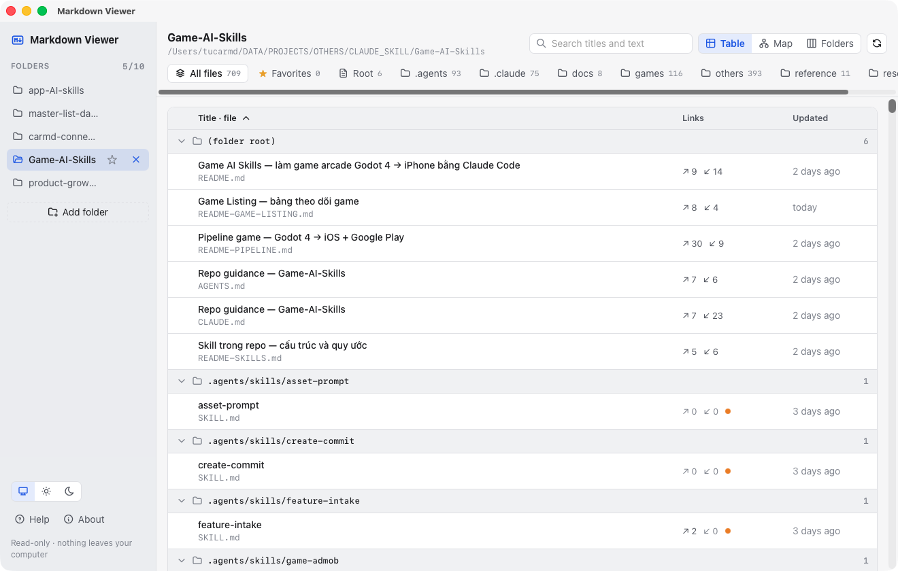

# Markdown Viewer

Make sense of a folder full of `.md` files. Point it at your docs, notes or AI skills folder and see every
Markdown file at a glance — as a **table** or a **map** of which file links to which. Click any file to read it,
follow its links, and jump back.

Free. No account, no ads, no data collection. It only reads the folders you choose, on your own computer.

## Download

| Platform | File |
|---|---|
| **macOS** 11+ (Apple silicon & Intel) | [Markdown-Viewer-mac.dmg](https://github.com/nvminhtu/markdown-viewer/releases/latest/download/Markdown-Viewer-mac.dmg) |
| **Windows** 10/11 (64-bit) — installer | [Markdown-Viewer-windows-setup.exe](https://github.com/nvminhtu/markdown-viewer/releases/latest/download/Markdown-Viewer-windows-setup.exe) |
| **Windows** — MSI (for IT / silent install) | [Markdown-Viewer-windows.msi](https://github.com/nvminhtu/markdown-viewer/releases/latest/download/Markdown-Viewer-windows.msi) |

All versions: [Releases](https://github.com/nvminhtu/markdown-viewer/releases).

### First launch

- **macOS:** if macOS says it can't verify the app, open **System Settings → Privacy & Security** and click
  **Open Anyway**. (A notarized build is on the way.)
- **Windows:** if SmartScreen shows "Windows protected your PC", click **More info → Run anyway**.

## What it does

- Up to **10 folders** in the sidebar; pin the ones you use most.
- Each subfolder becomes a tab. **Table** view: title, file name, links in/out, last updated. **Map** view: files
  as cards with arrows for links; files nobody links to get an orange dot.
- Read rendered Markdown with a table of contents, find in file (⌘F / Ctrl+F), Back/Forward between linked files.
- Search titles and text across every file. Favorite files (★).
- Updates by itself when files change on disk.

## Support

Product page: [oneclicktool.app](https://oneclicktool.app) · Issues: [open an issue](https://github.com/nvminhtu/markdown-viewer/issues).

The source code is not published in this repository; it only hosts the downloads.
