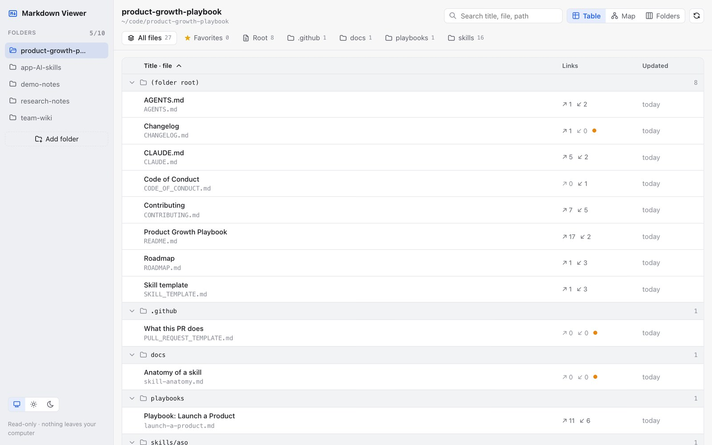
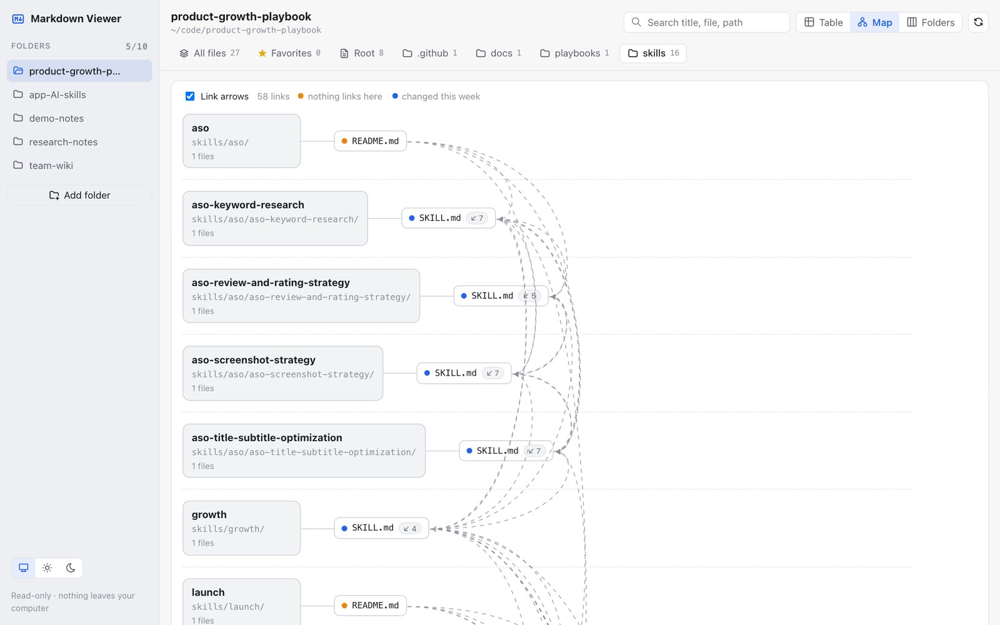
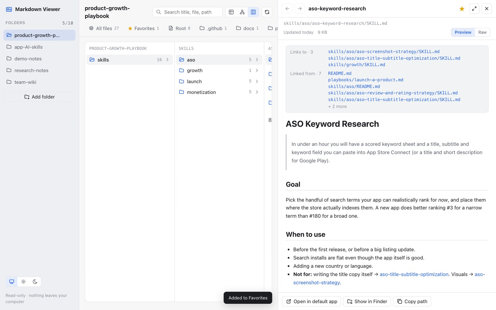

<p align="center"></p>

<h1 align="center">Markdown Viewer</h1>

<p align="center"><b>Make sense of a folder full of <code>.md</code> files.</b><br>
Free for macOS and Windows · no account · nothing leaves your computer</p>

<p align="center">
  <a href="https://github.com/nvminhtu/markdown-viewer/releases/latest/download/Markdown-Viewer-mac.dmg"><b>⬇ Download for Mac</b></a> ·
  <a href="https://github.com/nvminhtu/markdown-viewer/releases/latest/download/Markdown-Viewer-windows-setup.exe"><b>⬇ Download for Windows</b></a> ·
  <a href="https://oneclicktool.app/desktop/markdown-viewer?utm_source=github&utm_medium=readme&utm_campaign=markdown-viewer">Website</a>
</p>

Point it at your docs, notes, research or AI skills folder and see every Markdown file at a glance: as a
**table**, a **map** of which file links to which, or **Finder-style folders**. Click any file to read it, follow
its links, and jump back.



## Download

| Platform | File | Size |
|---|---|---|
| **macOS** 11 or later, Apple silicon & Intel | [Markdown-Viewer-mac.dmg](https://github.com/nvminhtu/markdown-viewer/releases/latest/download/Markdown-Viewer-mac.dmg) | 10 MB |
| **Windows** 10 / 11, 64-bit (recommended) | [Markdown-Viewer-windows-setup.exe](https://github.com/nvminhtu/markdown-viewer/releases/latest/download/Markdown-Viewer-windows-setup.exe) | 3.4 MB |
| **Windows** MSI, for IT / silent install | [Markdown-Viewer-windows.msi](https://github.com/nvminhtu/markdown-viewer/releases/latest/download/Markdown-Viewer-windows.msi) | 4.1 MB |

The links always give you the newest version. Older versions and checksums (`SHA256SUMS.txt`):
[Releases](https://github.com/nvminhtu/markdown-viewer/releases).

## Install

### macOS

1. Open **Markdown-Viewer-mac.dmg** and drag **Markdown Viewer** onto the **Applications** folder.
2. Open **Markdown Viewer** from Applications.
3. The first time, macOS says *"Markdown Viewer" Not Opened – Apple could not verify…*. Click **Done**.
   This version is not notarized by Apple yet; a notarized build is on the way.
4. Open **System Settings → Privacy & Security**, scroll down to *"Markdown Viewer" was blocked…* and click
   **Open Anyway**, then enter your Mac password and click **Open**.
5. That's it. From now on it opens normally.

<details><summary>Still blocked? (advanced)</summary>

In Terminal, remove the download flag, then open the app again:

```bash
xattr -dr com.apple.quarantine "/Applications/Markdown Viewer.app"
```
</details>

### Windows

1. Run **Markdown-Viewer-windows-setup.exe**.
2. If you see *"Windows protected your PC"* (SmartScreen), click **More info → Run anyway**. The installer is not
   code-signed yet.
3. Follow the installer. Markdown Viewer appears in the Start menu.

Windows 10 may download Microsoft Edge WebView2 during setup if it isn't installed yet (Windows 11 has it).

### Uninstall

- **macOS:** drag *Markdown Viewer* from Applications to the Trash.
- **Windows:** Settings → Apps → Installed apps → *Markdown Viewer* → Uninstall.

## What it does

| | |
|---|---|
|  |  |
| **Map** — files as cards, dashed arrows for links, orange dot for files nothing links to. | **Folders + reader** — drill in like Finder, read rendered Markdown, see links in and out. |

- Up to **10 folders** in the sidebar; pin the ones you use most.
- Each subfolder becomes a tab. **Table** view: title, file name, links in/out, last updated.
- Reader with table of contents, find in file (⌘F / Ctrl+F), Back/Forward between linked files.
- Search titles and text across every file. Star your favorite files.
- Refreshes by itself when files change on disk. Understands `[text](file.md)` and `[[wiki]]` links.

## Privacy

Markdown Viewer only **reads** the folders you add. It never edits, moves or uploads your files, has no account,
no analytics and no ads.

## Support

- Questions or bugs: [open an issue](https://github.com/nvminhtu/markdown-viewer/issues) (include your OS version).
- Website: [oneclicktool.app](https://oneclicktool.app/desktop/markdown-viewer?utm_source=github&utm_medium=readme&utm_campaign=markdown-viewer)

Made by [OneClickTool](https://oneclicktool.app/?utm_source=github&utm_medium=readme&utm_campaign=markdown-viewer).
This repository hosts the downloads; the source code is not published here.
